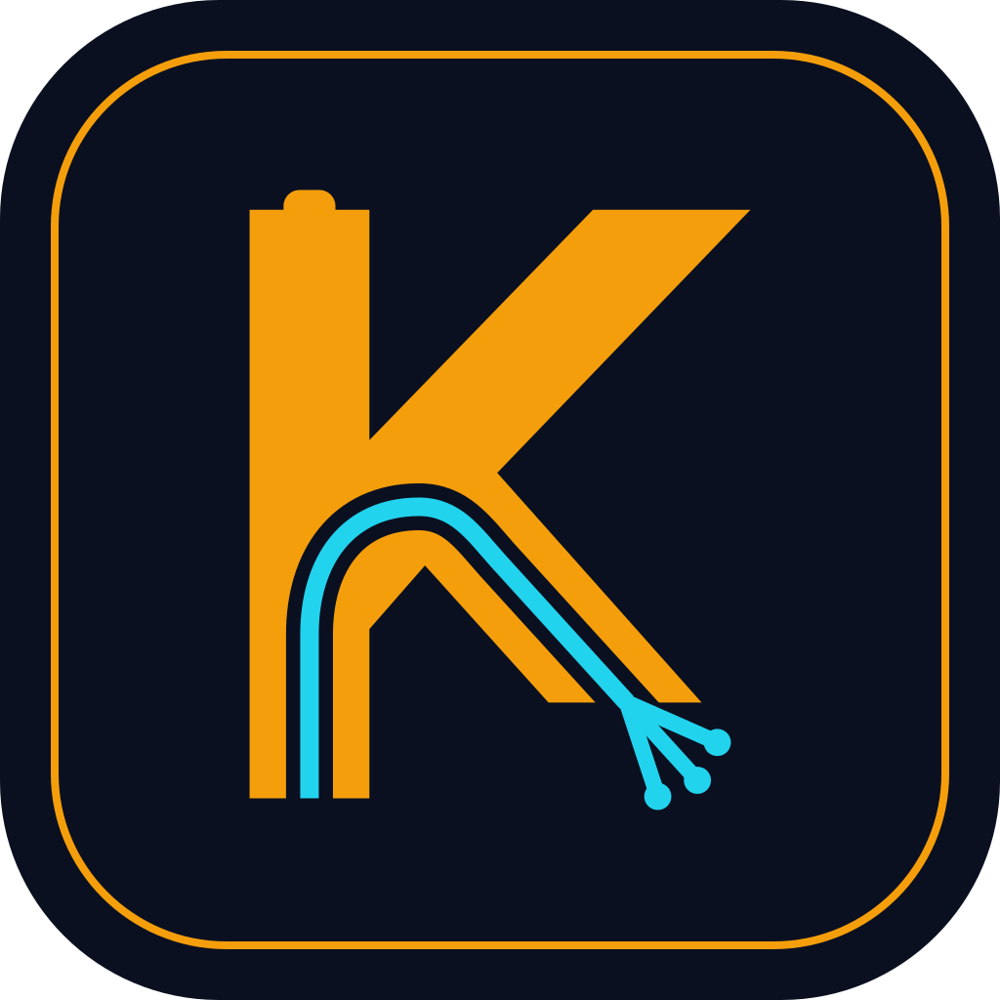

<p align="center">
  
</p>

# karez

[](LICENSE)
[](docs/STATUS.md)
[](https://www.rust-lang.org/)
[](docs/design/plan.md#3-standards-parity)
[](https://github.com/pmsudhi/cameleer)

### Database connectivity for Rust, shaped like JDBC, ODBC and ADBC.

**karez** is an open-source database connectivity library for Rust: one API and native drivers for
**PostgreSQL, MySQL and MariaDB, SQL Server and SQLite**. It follows the JDBC, ODBC and ADBC
standards, decodes results straight from the wire into **Apache Arrow** columnar chunks, and is
exported as an **ADBC driver, an ODBC driver and a JDBC driver**, so Python, Java, Go, .NET, R,
BI tools and query engines can use the same core. It is designed to be **fast, small and safe**.

> **Status: design stage with a working first slice.** A PostgreSQL client exists in this repository: five crates with no
> third-party dependencies, optional TLS, a pool, a shared pipelined connection, `COPY`, a partitioned parallel table scan and
> a multi-row insert (see [What exists today](#what-exists-today)). It is **verified against a real server on PostgreSQL 14.25,
> 16.15 and 17.12 (versions 13, 15 and 18 were not run)** and the whole test suite passes. It is **not released**: the code is not
> published, and the crates.io names are reserved with empty placeholders. The speed figures below are first measurements (one
> lane per competitor), not a finished benchmark; the full test is pending. Everything beyond PostgreSQL (MySQL, SQL Server, SQLite,
> the ADBC, ODBC and JDBC exports) is a plan. The first milestone is still a go or no-go measurement spike (see
> [Design targets](#design-targets-and-where-they-stand)).

[Plan](docs/design/plan.md) · [Research](docs/design/research.md) · [Status](docs/STATUS.md) ·
[Why](#why-another-database-library) · [Planned API](#the-planned-api) · [Targets](#design-targets-not-measurements) ·
[Roadmap](#roadmap) · [The name](#what-the-name-means) · [FAQ](#faq)

---

## At a glance: first measurements (the full test is still pending)

Measured on the PostgreSQL client in this repository, on 13 million rows of public NYC taxi data and a 1-million-row table. Every
figure is `[measured here]`, from one lane per competitor (one database droplet and one client droplet, DigitalOcean `c-4`, 2026-11-14
to 2026-11-16) or from a laptop; the sources and the losses are in [docs/design/perf-program.md](docs/design/perf-program.md).

- **Up to 3.4x faster bulk reads** with the partitioned scan (`scan_partitioned`: one table read on several connections from one
  snapshot) than the best single-connection client, **when the network is not the limit** (13M rows, database and client on one machine,
  12 shared CPUs: 3.4x; 1M rows: 2.4x).
- **On a real cloud link the gain is smaller: 1.1x to 1.3x** (1.23x to 1.28x on the 13M-row scan, 1.12x on the 1M-row scan), because the 1.9 Gbit/s
  link between two DigitalOcean `c-4` droplets is full. A faster two-machine network is the deciding test and has **not been run yet**.
- **About half the client CPU** of tokio-postgres on a large scan (6 to 7.7 CPU-seconds against 12 to 14 for 13M rows).
- **Level with the best Rust clients on single-row queries**, which are limited by the database server, not by the client; one-connection
  latency is within 7% of a raw-protocol floor.
- **Inserts:** the multi-row `insert_batch` is 1.75x karez's own per-row path and level with sqlx.
- **Small:** a stripped blocking hello-world is 441 KiB with no third-party crates (tokio-postgres: 824 KiB and 68 crates; sqlx: 1,060 KiB
  and 147 crates).

**Pending:** the faster-network test, a complete multi-round campaign against every competitor (round results will replace the
one-lane figures above), and diesel and rusqlite comparisons. These are first measurements and will change. Where karez is level or behind,
the tables say so.

## Why another database library

Rust has good database crates, and each makes a trade-off that karez is designed to avoid.
The evidence behind each point is in [docs/design/research.md](docs/design/research.md), with its
source and the date it was checked.

- **The client library, not the language, decides OLTP speed.** On TechEmpower Round 23 (Fortunes,
  identical hardware), the same web framework served 1,114,265 requests per second with
  tokio-postgres and 38,712 with sqlx, a 20 to 40 times spread. Every fast entry used a dedicated
  connection task with pipelining.
- **Row-by-row transfer is the expensive part of bulk reads.** A 2017 VLDB study found that
  mainstream database protocols were 10 to 60 times slower than shipping the same data over a raw
  socket, because of per-row headers and per-value decoding, not because of query execution.
  Column-major chunks of about 1 MB closed most of the gap.
- **There is no common, standards-shaped Rust API.** [tokio-rs/rdbc](https://github.com/tokio-rs/rdbc)
  tried and has been dormant since 2021. sqlx's `Any` driver covers nine scalar type kinds.
  Pipelining in sqlx is an open issue since 2020; a pull request for it was closed unmerged in
  September 2026 as needing a redesign.
- **JDBC is the only way into Spark, Trino and Kafka Connect, and it is row-oriented.** In
  published bulk-read measurements, Arrow-based transfer was 13 to 30 times faster than row-based
  JDBC and ODBC paths, although one 2026 test measured a single-stream Flight SQL query 10 to 15
  percent slower than JDBC. Arrow only helps where the consumer can use it.
- **Rust has client-side ODBC bindings but we found no shipping Rust ODBC driver,** so BI tools
  such as Power BI, Tableau and Excel cannot reach a Rust database core directly.

karez's answer: one columnar decoding path under every API, a pipelined connection, a type model
as wide as JDBC, ODBC and Arrow together, and three exports from one C ABI.

## What exists today

Five library crates and a top-level crate, with **no third-party dependencies** and `#![forbid(unsafe_code)]` in each (TLS is an
optional feature that adds rustls). Details, test counts and commands are in
[docs/design/m0-spike-results.md](docs/design/m0-spike-results.md); the measurements are in
[docs/design/perf-program.md](docs/design/perf-program.md).

| crate | what it is |
|---|---|
| `karez-chunk` | an Arrow-layout columnar chunk: validity bitmap plus fixed-width data, or offsets plus bytes; a reusable builder; checked typed readers |
| `karez-proto-pg` | the PostgreSQL 3.0 wire protocol without any I/O: framing with a size limit, the startup, authentication and extended-query messages, binary row decoding into chunks, and SCRAM-SHA-256 with SHA-256, HMAC, PBKDF2 and base64 written in-repo |
| `karez-pg` | a blocking connection: URL parsing, trust, cleartext and SCRAM authentication behind an allow-list, a per-connection prepared-statement cache, server-side parameter binding only, a streaming cursor (row view and `next_chunk`), transactions with savepoints, errors with SQLSTATE, a first-come-first-served pool, batches in one round trip, `COPY` in and out, `LISTEN`/`NOTIFY`, cancellation, **`scan_partitioned`** (one table read on several connections from one snapshot) and **`insert_batch`** (multi-row insert) |
| `karez-rt` | a shared connection that many threads or futures on any executor can pipeline over, with no async runtime |
| `karez` | the top-level crate: re-exports the above; one runnable example in `crates/karez/examples/orders.rs` and doc examples for the partitioned scan and `insert_batch` |

The repository also holds the benchmark harness (`bench/`: an open-loop load generator, adapters for 16 PostgreSQL clients, scripts that run
it on DigitalOcean and delete the machines) and the results.

Limits, stated plainly:

- **PostgreSQL only.** No MySQL, SQL Server or SQLite yet.
- **Not published.** The working code is not on crates.io. The names `karez`, `karez-chunk`, `karez-proto-pg`, `karez-pg` and `karez-rt` are
  reserved there with 0.0.1 placeholder releases that contain no code; they are not the library.
- **TLS is optional.** With the `tls` feature (rustls) the default `sslmode` is `verify-full`; without it a connection needs an explicit `sslmode=disable`, and the core has no dependencies. It works over the shared `karez-rt` connection too. See [docs/design/tls-decision.md](docs/design/tls-decision.md).
- **Three server versions tested.** Real-server tests ran on PostgreSQL 14.25, 16.15 and 17.12 (the partitioned scan needs 14 or later). Versions 13, 15 and 18 were not run by the test suite. The 13 to 18 range in the plan is a target, not something tested.
- **Types.** Native columns: `bool`, `int2`, `int4`, `int8`, `float4`, `float8`, `text`, `varchar`, `bpchar`, `name`, `bytea`, `uuid`, `date`, `timestamp`, `timestamptz`, `oid` and NULL. `numeric`, `json`, `jsonb`, `interval`, `time`, `timetz`, `inet`, `cidr`, `macaddr`, `bit`, enums and arrays of these are read in binary and delivered as exact text (not as Arrow decimal, interval or list columns). Any other type (for example `money`, ranges, `tsvector`) fails with an error that names the type, or is read as text with `unsupported_types=text`.
- **Timestamp range.** Values are Unix-epoch microseconds, so PostgreSQL timestamps in roughly its last 30 years of range (after about year 294246) give an error. Dates, `infinity` and `-infinity` are handled.
- **Speed.** Only first measurements exist ([At a glance](#at-a-glance-first-measurements-the-full-test-is-still-pending)); there is no
  finished benchmark and no claim that karez is the fastest.

## What karez will be

| area | plan |
|---|---|
| Databases | PostgreSQL 13 to 18, MySQL 8.0 to 9.x, MariaDB 10.6 to 11.x, SQL Server 2017 and later (TDS 7.4 and 8.0 strict), SQLite 3.45 and later, and an ODBC bridge for everything else |
| Core | one API with blocking and async forms, transactions and savepoints, prepared-statement caching, pipelining, batches and bulk load, metadata, SQLSTATE errors, cancellation, a fair connection pool |
| Results | decoded from the receive buffer into Arrow-layout chunks (about 1,024 rows or 1 MiB), with a zero-allocation row view on top and a zero-copy columnar view |
| Standards | JDBC 4.3 plus the 4.4 and 4.5 surface, ODBC 3.8 Core and Level 1, ADBC 1.1.0, and a port of the R2DBC test suite for the async API. Parity is declared per standard and per level |
| Exports | an ADBC driver (one shared library plus a manifest), a JDBC driver for Java 22 and later through the foreign function API, an ODBC driver, Python wheels with DB-API 2.0 and an Arrow stream, and Node bindings |
| Safety | server-side parameter binding only, verified TLS by default, an allow-list for authentication methods, checked length arithmetic, fuzzed decoders, `forbid(unsafe_code)` outside two crates |
| Size | no dependencies in the core, per-driver Cargo features, and a stripped PostgreSQL hello-world of at most 600 KB (measured for the PostgreSQL slice: 441 KiB) |

## The planned API

This is a sketch from [docs/design/plan.md](docs/design/plan.md), **not code that exists as
written**: `Url`, the driver registry, `Decimal128`, `to_arrow_c_stream` and `pipeline` are not
built. What does exist is in [What exists today](#what-exists-today); the same row and chunk views
work there with `Connection::connect_url` and `Connection::query`.
It shows the intent: JDBC-shaped use with no per-row allocation, and the same cursor as Arrow.

```rust
use karez::{Value, Url, Isolation};

let url = Url::parse("karez:pg://app@db.internal:5432/sales?sslmode=verify-full")?;
let mut conn = karez::drivers().get(&url)?.connect(&url, &Credentials::from_env()?)?;

let stmt = conn.prepare("SELECT id, total FROM orders WHERE customer = ?")?;   // cached per connection

// Row view: JDBC-shaped, zero allocation.
let mut cur = stmt.query(&[Value::i64(7)])?;
while let Some(row) = cur.next()? {
    let id: i64 = row.get(0)?;
    let total: Decimal128 = row.get(1)?;
}

// Columnar view: the same cursor, whole chunks, zero copy into Arrow.
while let Some(chunk) = stmt.query(&[Value::i64(7)])?.next_chunk()? {
    let stream = chunk.to_arrow_c_stream();
}

// Pipelining, transactions, bulk.
let results = conn.pipeline().query(&stmt, &[Value::i64(1)]).query(&stmt, &[Value::i64(2)]).run()?;
let mut tx = conn.begin(Isolation::RepeatableRead)?;
tx.commit()?;
```

## Design targets and where they stand

These are the pass marks for Milestone 0, the go or no-go spike, on PostgreSQL, with an open-loop benchmark on separate machines that
reports pipelined and unpipelined numbers separately. The method is in [docs/design/plan.md](docs/design/plan.md#6-benchmark-method). The
right-hand column is the state on 2026-11-16 from one lane per competitor; the full test is pending
([plan section 1.3](docs/design/plan.md#13-what-milestone-0-must-show-before-the-build-goes-ahead) has the details).

| scenario | must show to continue | where it stands |
|---|---|---|
| Point query, unpipelined, 64 connections | within 5% of the fastest Rust client, and at least 2x tuned pgJDBC | **level** with the best Rust clients (the database host is the limit); about 1.2x pgJDBC, not 2x |
| One connection, one request at a time | within 5% of the fastest Rust client | **met**: within 7% of a raw-protocol floor and level with the best clients |
| Bulk scan into Arrow | at least 2x the best Rust row API, at least 3x tuned pgJDBC, at most one third of its memory | **not met on a 1.9 Gbit/s cloud link** (1.1x to 1.3x with the partitioned scan); **met with no network limit** (2.4x to 3.4x); faster-network test pending |
| Size | a stripped PostgreSQL hello-world of at most 600 KB, with zero direct dependencies | **met**: 441 KiB, zero third-party crates |

On single-row queries the evidence supports parity with the best existing clients, not a large margin. The large margin is on the bulk
and columnar path, and every claim names the API surface it applies to. If the bulk path misses its mark on the network the owner
measures next, the plan falls back to a thin standards-shaped API over tokio-postgres.

## Roadmap

About 49 engineer-weeks to 1.0, or roughly 30 calendar weeks with milestones in parallel.
Details, exit targets and risks are in [docs/design/plan.md](docs/design/plan.md#8-milestones-and-measurable-targets).

| milestone | what | effort |
|---|---|---|
| M0 | PostgreSQL measurement spike (go or no-go) | 3 weeks |
| M1 | core API and the full PostgreSQL driver, TLS, pool, fuzzing | 8 weeks |
| M2 | MySQL and MariaDB | 6 weeks |
| M3 | SQL Server (TDS 7.4 and 8.0) | 7 weeks |
| M4 | SQLite and the ODBC bridge | 4 weeks |
| M5 | ADBC driver, C ABI, Python wheels, Node | 5 weeks |
| M6 | JDBC driver for Java 22 and later | 6 weeks |
| M7 | ODBC driver | 6 weeks |
| M8 | hardening, audit and 1.0 | 4 weeks |

## What the name means

A **karez** (also written *kariz* or *kahriz*; *qanat* in Arabic and Persian contexts, *falaj*
in Oman) is an ancient underground water channel. A tunnel with a very gentle slope carries water
from a deep aquifer to a village and its fields by gravity alone, with no pumps, and the water
does not evaporate in the desert sun. A row of vertical shafts along the tunnel lets people dig it
and keep it clean. The Persian qanats are a UNESCO World Heritage Site.

The database is the aquifer, your applications and data tools are the fields, and karez is the
channel between them: it moves the precious thing a long way in bulk, with no pumping, and with
access shafts along the way. The alternative it replaces is carrying water one bucket at a time,
which is how row-by-row drivers work.

karez belongs to the [Cameleer](https://github.com/pmsudhi/cameleer) family, a set of Rust
projects with a desert and camel naming theme. Its siblings include Cameleer, the integration
engine, and simoom, the HTTP server engine.

## FAQ

**What is karez?** An open-source database connectivity library for Rust, planned as one API plus
native drivers for PostgreSQL, MySQL and MariaDB, SQL Server and SQLite, with JDBC, ODBC and ADBC
parity and exports. It is the Rust counterpart of what JDBC and ODBC are for Java and C.

**Can I use it today?** Only as a spike, from this repository. A PostgreSQL client exists, with optional TLS, a pool, a shared
pipelined connection, a partitioned parallel scan and a multi-row insert, tested against a real server on PostgreSQL 14.25, 16.15 and
17.12, with first measurements. It is not released and its code is not published (the crates.io names hold empty placeholders). The
rest is research, the plan and the brand assets.

**Is it a fork of tokio-rs/rdbc?** No. It starts fresh with no code or history from rdbc, which
is cited as prior work. rdbc has been dormant since 2021.

**Is it faster than JDBC?** On first measurements, about 1.2x tuned pgJDBC on point queries at 64 connections (the target was 2x; the
database server is the limit there) and about 1.7x pgJDBC with default settings on a 1-million-row scan; with the partitioned scan the
bulk-read gain over the best single-connection Rust client is 1.1x to 1.3x on a 1.9 Gbit/s cloud link and up to 3.4x with no network
limit. These are one-lane figures and the full test is pending. Existing Rust clients such as tokio-postgres already beat JDBC on point
queries, so the aim there is parity with the fastest Rust client; the larger gain is on bulk reads into Arrow.

**Why not just use sqlx, tokio-postgres or diesel?** They are good libraries. karez targets a
different shape: one standards-shaped API across several databases, a columnar result path,
pipelining on every driver that allows it, and exports for ADBC, ODBC and JDBC so other
ecosystems can use it. diesel is an ORM and query builder, sqlx is an async toolkit, and
tokio-postgres is a PostgreSQL driver; none of them is an ODBC or JDBC driver.

**Will it be "JDBC compliant"?** Not in the formal sense. Formal JDBC compliance needs Oracle's
licensed test kit. karez will claim "JDBC 4.3 API-complete" and publish its own test suite.
Parity is declared per standard and per level.

**Which databases?** PostgreSQL, MySQL, MariaDB, SQL Server and SQLite first. ClickHouse, DuckDB,
a Flight SQL client and the Arrow-based cloud warehouses are candidates after 1.0. Oracle is held
out pending a legal review of its undocumented protocol.

**Is it async?** Both forms are planned. The blocking API drives the connection from the
caller's thread with no thread hop. In diesel's published benchmark suite, async SQLite wrappers
were 20 to 60 times slower than rusqlite, and the fastest async PostgreSQL client was about 37
percent slower than the fastest synchronous one on single queries.

**What licence?** Apache-2.0.

## Documentation

- [docs/design/plan.md](docs/design/plan.md): the decision, architecture, API, standards parity, size budget, benchmark method, security rules, milestones and risks.
- [docs/design/research.md](docs/design/research.md): the evidence, in 13 sections with sources and check dates.
- [docs/research/](docs/research/): the seven research notes behind it (Rust landscape, standards, wire protocols, papers and mathematics, JDBC baseline, security and testing, bridges).
- [docs/STATUS.md](docs/STATUS.md): current state and next steps.
- [docs/brand/](docs/brand/) and [assets/](assets/README.md): logo, icons and the generator that builds them.
- [llms.txt](llms.txt) and [AGENTS.md](AGENTS.md): the same facts for LLMs and coding agents.

## Contributing, security and citing

Ideas, corrections to the research, and benchmark methodology reviews are welcome now; the
PostgreSQL spike described above is the code to review. See [CONTRIBUTING.md](CONTRIBUTING.md), [SECURITY.md](SECURITY.md)
and [CODE_OF_CONDUCT.md](CODE_OF_CONDUCT.md). To cite karez, use [CITATION.cff](CITATION.cff).

## License and credits

Licensed under the [Apache License 2.0](LICENSE). karez is an independent project. It is not
affiliated with Oracle, Microsoft, the Apache Software Foundation or the owners of any database
named here; JDBC, ODBC, ADBC, Apache Arrow, PostgreSQL, MySQL, MariaDB, SQL Server and SQLite are
names of their respective owners. The prior work it builds on in spirit, and its research
sources, are credited in [NOTICE](NOTICE) and in [docs/design/research.md](docs/design/research.md).
